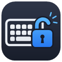

<p align="center">
  
</p>

<h1 align="center">KeyboardLock</h1>

<p align="center">단축키 하나로 키보드를 잠그는 Windows 트레이 프로그램</p>

---

책을 키보드 위에 올려두거나, 고양이가 키보드를 밟거나, 화면을 켜둔 채 키보드를 닦을 때 입력이 들어가지 않도록 키보드를 잠급니다. 마우스는 잠기지 않습니다.

## 기능

- **단축키로 잠금/해제** — `Ctrl + Alt + Shift + K` (같은 키로 잠그고 풉니다)
- **트레이 아이콘으로 상태 표시** — 🔴 닫힌 자물쇠 = 잠김, 🟢 열린 자물쇠 = 해제
- **마우스 오버 시 상태와 단축키 안내** — 단축키를 잊어도 확인할 수 있습니다
- **아이콘 클릭으로 잠금/해제** — 키보드가 잠겨 있어도 마우스로 풀 수 있습니다
- **잠금/해제 시 화면 알림** — 화면 아래쪽에 잠깐 표시되고 사라집니다
- **Windows 시작 시 자동 실행** — 트레이 메뉴에서 켜고 끌 수 있습니다
- **설치 불필요** — exe 파일 하나로 실행됩니다 (Windows 기본 .NET Framework 4.x 사용)

## 단축키를 이렇게 정한 이유

`Ctrl + Alt + Shift + K`는 키보드에 물건이 올라갔을 때 **실수로 눌리지 않도록** 골랐습니다.

- **세 줄에 걸쳐 떨어져 있음** — Ctrl·Alt(맨 아랫줄), Shift(그 윗줄), K(가운데 줄 오른쪽). 책등처럼 길고 납작한 물체로는 한 번에 누를 수 없습니다.
- **정확히 4개만 눌려야 인식** — 다른 키가 하나라도 함께 눌려 있으면 무시합니다.
- **새로 누를 때만 인식** — 이미 눌려 있던 K는 인정하지 않아서, 물건을 올려둔 채로 두어도 반응하지 않습니다.
- **다른 단축키와 겹치지 않음** — Windows 기본 단축키와 충돌하지 않고, 인식되면 K 입력은 다른 프로그램에 전달되지 않습니다.

## 사용법

1. [Releases](../../releases)에서 `KeyboardLock.exe`를 내려받아 실행합니다.
2. 화면 오른쪽 아래 트레이에 자물쇠 아이콘이 나타납니다. (안 보이면 시계 옆 **^**를 누르세요)
3. `Ctrl + Alt + Shift + K`로 잠그고, 같은 키로 풉니다.

| 동작 | 방법 |
|---|---|
| 잠금 / 해제 | `Ctrl + Alt + Shift + K` 또는 트레이 아이콘 왼쪽 클릭 |
| 상태·단축키 확인 | 트레이 아이콘에 마우스 올리기 |
| 자동 실행 설정 | 트레이 아이콘 오른쪽 클릭 → **Windows 시작 시 자동 실행** |
| 종료 | 트레이 아이콘 오른쪽 클릭 → **종료** |

## 직접 빌드하기

별도 설치 없이 Windows에 기본으로 있는 C# 컴파일러로 빌드합니다.

```bat
build.bat
```

`KeyboardLock.exe`가 같은 폴더에 만들어집니다. 프로그램이 실행 중이면 빌드가 실패하니 먼저 종료하세요.

단축키를 바꾸려면 `KeyboardLock.cs` 위쪽의 `TriggerVk`(키 코드)와 `HotkeyText`(안내 문구)를 수정한 뒤 다시 빌드하세요.

## 알아두실 점

- **`Ctrl + Alt + Del`은 막을 수 없습니다.** Windows가 보호하는 키라서, 반대로 비상 탈출 수단이 됩니다. 이 화면에서 작업 관리자를 열어 KeyboardLock을 종료하면 키보드가 바로 풀립니다.
- **관리자 권한으로 실행된 창**이 앞에 있을 때는 그 창에 잠금이 적용되지 않을 수 있습니다. (Windows 보안 제한)
- 화상 키보드나 원격 제어 도구처럼 **소프트웨어로 입력되는 키는 막지 않습니다.**
- 아이콘을 바꿨는데 탐색기에 예전 아이콘이 보이면 Windows 아이콘 캐시 때문입니다. PC를 다시 시작하면 바뀝니다.

## 파일 구성

| 파일 | 설명 |
|---|---|
| `KeyboardLock.cs` | 전체 소스 코드 |
| `build.bat` | 빌드 스크립트 |
| `app.ico` | 실행 파일 아이콘 (16~256px) |
| `docs/icon.png` | README용 아이콘 이미지 |
